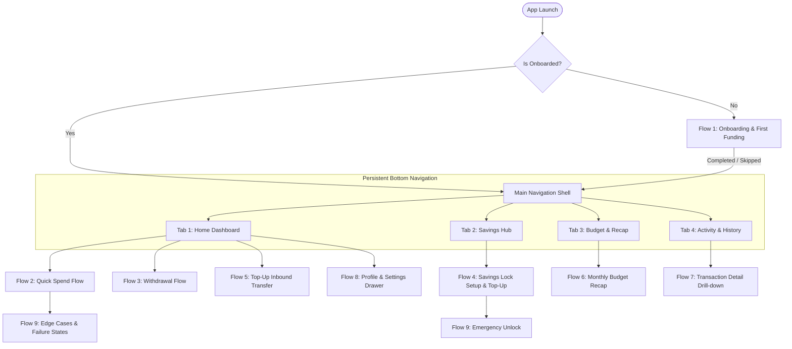
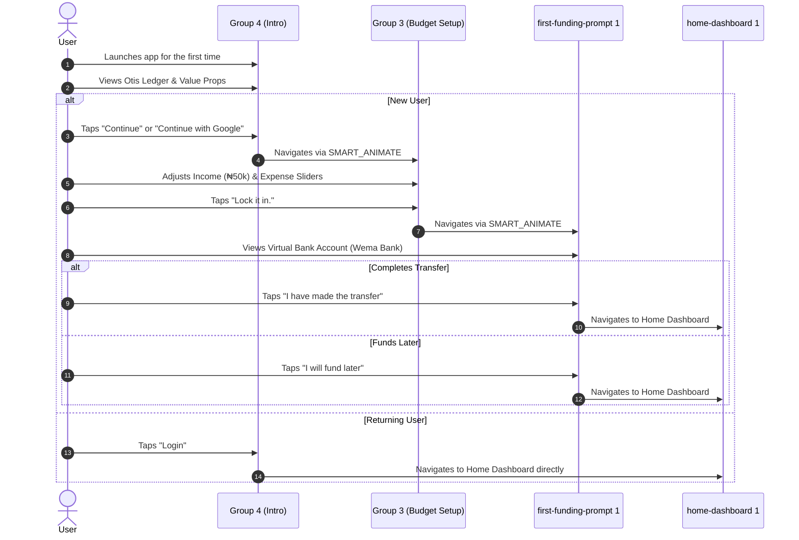
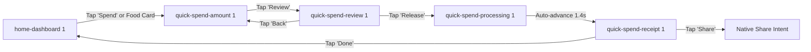
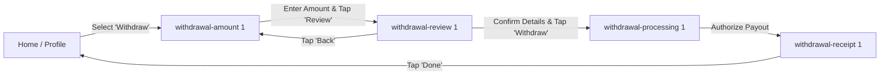
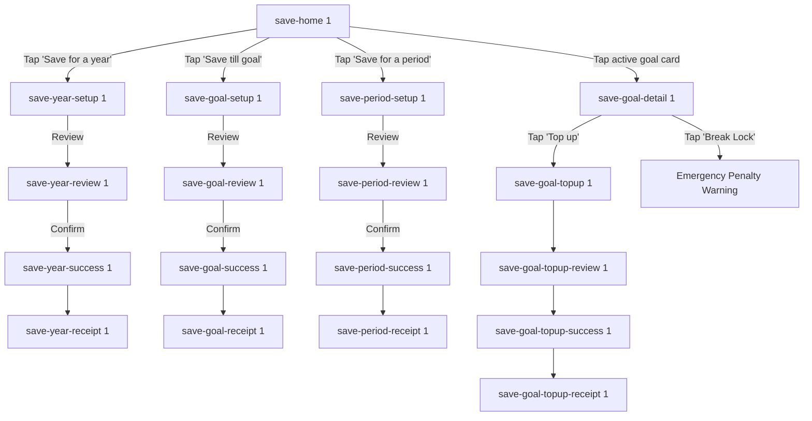
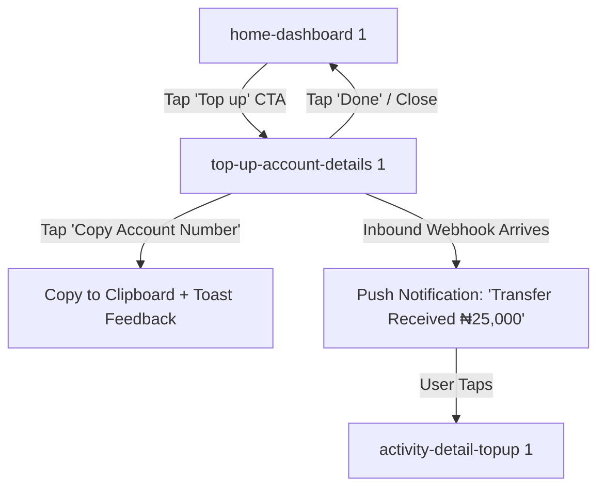
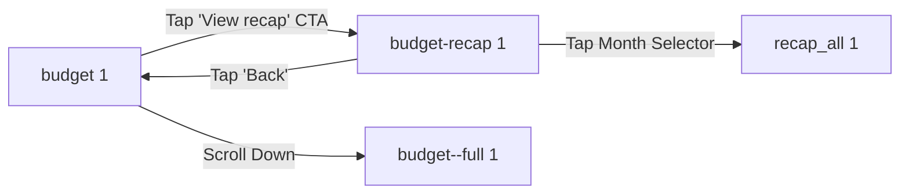
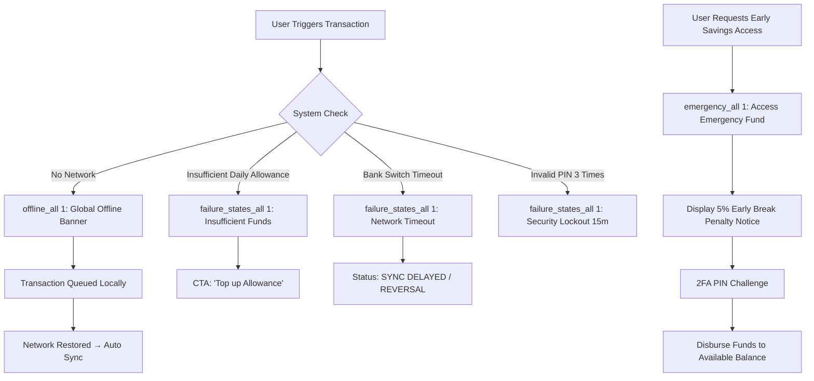

# LOCKBUDGET — NAVIGATION FLOWS & PROTOTYPE TOPOLOGY

**Generated:** Phase 1 Discovery & Audit  
**Source of Truth:** `figma_scripter_clean.js`, `figma_scripter_v5.js`, `figma_plugin/code.js`, `lockbudget.penpot`

---

## 1. Master Navigation Architecture

The LockBudget application is organized into a **Root Shell** that handles initial authentication/onboarding state, routing into a persistent **4-Tab Navigation Shell**, with deep-linkable modal sub-flows for transactional interactions.



---

## 2. Detailed Sub-Flows

### Flow 1: Onboarding & First Funding Flow


---

### Flow 2: Quick Spend Execution Flow


---

### Flow 3: Bank Withdrawal Flow


---

### Flow 4: Savings Lock Setup & Management


---

### Flow 5: Top-Up Inbound Transfer Flow


---

### Flow 6: Budget & Monthly Recap Flow


---

### Flow 7: Activity History & Transaction Drill-down
```mermaid
flowchart TD
    ActivityTab[activity 1] -->|Tap Food Item| DetailFood[activity-detail-food 1]
    ActivityTab -->|Tap Airtime/Internet| DetailNet[activity-detail-internet 1]
    ActivityTab -->|Tap Electricity| DetailElec[activity-detail-electricity 1]
    ActivityTab -->|Tap Savings Deposit| DetailSave[activity-detail-save 1]
    ActivityTab -->|Tap Inbound Transfer| DetailTopup[activity-detail-topup 1]
    ActivityTab -->|Tap Withdrawal| DetailWithdraw[activity-detail-withdrawal 1]
    
    DetailFood --> StatusDone[Status: DONE (Green)]
    DetailFood --> StatusPending[Status: PENDING (Amber) - activity-detail-pending 1]
    DetailFood --> StatusFailed[Status: FAILED (Red) - activity-detail-failed 1]
    DetailFood --> StatusSyncDelayed[Status: SYNC DELAYED - activity-detail-sync-delayed 1]
    
    StatusFailed --> FullRCA[activity-detail-failed--full 1]
    StatusSyncDelayed --> FullSync[activity-detail-sync-delayed--full 1]
```

---

### Flow 8: Profile, Settings, Security, & Support Flow
```mermaid
flowchart TD
    Dashboard[home-dashboard 1] -->|Tap Otis Avatar| ProfileWindow[profile-window 2]
    
    ProfileWindow -->|Personal Profile| UserProfile[user-profile 2 / user-profile--full 1]
    ProfileWindow -->|Personal Bank Account| BankAccounts[personal-bank-account 2]
    ProfileWindow -->|Security Settings| Security[security-settings 2]
    ProfileWindow -->|Notification Settings| Notifications[notification-settings 2]
    ProfileWindow -->|Help & Support| HelpSupport[help-support 2]
    ProfileWindow -->|General Settings| Settings[settings 2 / settings--full 1]
    ProfileWindow -->|Delete Account| DeleteConfirmation[delete-account-confirmation 2]
    ProfileWindow -->|Logout| IntroScreen[Group 4 (Intro Screen)]
    
    Security -->|Change PIN| PinResetFlow[PIN Reset via OTP Challenge]
    Security -->|Biometrics Toggle| BiometricsAuth[LocalAuth Challenge]
    HelpSupport -->|Live Chat| LiveChatModal[In-App Support Chat]
    HelpSupport -->|WhatsApp| ExternalWhatsApp[Launch WhatsApp URL]
```

---

### Flow 9: Failure, Offline, & Emergency Unlock Flows

